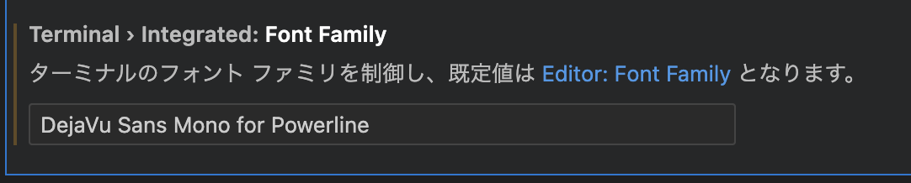

# mac 　初期設定

## mac の設定

ライブ変換無効
ドラッグロック
３本指でのアプリケーション切り替え有効
バッテリー%表示
メール設定
vivaldi インストール

iterm2 インストール
CotEditor インストール

## Vscode

- vscode インストール
  https://code.visualstudio.com/docs/?dv=darwinarm64

## GitHub 設定

- git は初期インストール済だった。
- 鍵コピー
- config コピー

### ユーザ設定

```sh
git config --global user.name "ユーザー名"
git config --global user.email メールアドレス
```

.DS_Store を ignore する。

```sh
mkdir -p ~/.config/git
echo '.DS_Store' >> ~/.config/git/ignore
```

## Zsh 設定

- git 設定

## brew インストール

https://brew.sh/ja/

## aws cli v2 インストール

```sh
curl "https://awscli.amazonaws.com/AWSCLIV2.pkg" -o "AWSCLIV2.pkg"
sudo installer -pkg AWSCLIV2.pkg -target /
```

```
installer: This package requires Rosetta 2 to be installed.
                Please install Rosetta 2 and then try again.
                    `sudo softwareupdate --install-rosetta`

installer: Error - AWS Command Line Interfaceはこのコンピュータにインストールできません。
```

→Rosetta2 のインストールが必要。

### 代替

```sh
brew install awscli
```

```
aws     compgen:96: no such file or directory: /usr/local/bin/aws_completer
```

とコマンド補完が効かないので
`/opt/homebrew/Cellar/awscli/2.9.15/libexec/bin/aws_completer`に対してシンボリックリンクを貼る。

```sh
sudo ln -s /opt/homebrew/Cellar/awscli/2.12.1/libexec/bin/aws_completer /usr/local/bin/aws_completer
```

awscli 配下のバージョンはインストールのタイミングで異なるので、確認してから実行すること
`/usr/local/bin/aws_completer`がすでに存在した場合は削除してから実行する。

#### アップグレードする場合

```sh
brew update
```

```sh
brew upgrade awscli
```

- 再度シンボリックリンク作成

```sh
sudo rm -f /usr/local/bin/aws_completer
sudo ln -s /opt/homebrew/Cellar/awscli/2.11.20/libexec/bin/aws_completer /usr/local/bin/aws_completer
```

## awsp インストール

```sh
npm install -g awsp
```

zsh: command not found: npm
npm がインストールされていない。

### npm インストール

参考記事:https://qiita.com/shinobear01/items/440c5f89c10a35f916b3

- nodebrew Install

```sh
brew install nodebrew
```

- Version 確認

```sh
nodebrew -v
```

- 最新 Node.js インストール

```sh
mkdir -p ~/.nodebrew/src
```

```sh
nodebrew install-binary latest
```

- Version 確認

```sh
nodebrew use latest
export PATH=$HOME/.nodebrew/current/bin:$PATH
npm -v
```

## peco インストール

```sh
brew install peco
```

## Authy インストール

AppStore からインストール

## Slack インストール

AppStore からインストール

## Terraform インストール（推奨手順）

公式の推奨方法は Homebrew で直接インストールする方法です。

```sh
brew tap hashicorp/tap
brew install hashicorp/tap/terraform
```

インストール後、バージョン確認：

```sh
terraform -v
```

バージョンを切り替えたい場合は asdf などのバージョン管理ツールの利用が推奨されています。

### 参考

- [Terraform 公式インストール手順](https://developer.hashicorp.com/terraform/tutorials/aws-get-started/install-cli)

- Directory 作成

```sh
mkdir ~/.terraform.d/plugin-cache
```

- Version 確認

```sh
terraform -v
```

Terraform v1.3.7
on darwin_arm64
→ `darwin_arm64`になっていることを確認。

### aws-vault インストール

```sh
brew install --cask aws-vault
```

一定期間経過するとパスワードをきかれてしまうためようになるため
キーチェーンのタイムアウトを伸ばす。
https://qiita.com/minamijoyo/items/5ed3113434e51308ded1

```sh
open ~/Library/Keychains/aws-vault.keychain-db
```

左のペインで`aws-vault`を右クリックし、
操作しない状態が〜、とスリープ時にロックのチェックを外す。

## Terraform-docs

```sh
brew install terraform-docs
```

## /usr/local/bin 設定

## aws alias 設定

```sh
cp -p aws/cli/alias ~/.aws/cli/
```

## Finch インストール

https://github.com/runfinch/finch

- 初回起動

```sh
finch vm init
```

- 起動する場合　※1 init 直後は起動している。

```sh
finch vm start
```

```sh
finch run --rm public.ecr.aws/finch/hello-finch
```

## Docker For Mac インストール

https://docs.docker.com/desktop/install/mac-install/

## Go インストール

```sh
brew install go
```

---

## zsh プロンプト設定

```sh
cp -p .zshrc ~/
cp -pr zsh ~/.zsh 
```

```sh
brew install romkatv/powerlevel10k/powerlevel10k
echo "source $(brew --prefix)/opt/powerlevel10k/powerlevel10k.zsh-theme" >>~/.zshrc
```

- 特殊フォントインストール

```sh
cd ~/
git clone https://github.com/powerline/fonts
 cd fonts
 ./install.sh
```

ターミナルの設定画面でフォントを「DejaVu Sans Mono Powerline」に変更します。

このままでは Vscode の terminal の文字コードが表示されないので
Vscode の設定も変更します。

Vscode の設定で以下を追加

```json
{
    [...]
    "terminal.integrated.fontFamily": "DejaVu Sans Mono for Powerline",
    [...]
}
```



## infracost

```sh
brew install infracost
```

## GitHub CLI Install for Apple Silicon

- Install

```sh
brew install gh
```

- Auth

```sh
gh auth login
```

- Upgrade

```sh
brew upgrade gh
```

- Uninstall

```sh
brew uninstall gh
```
